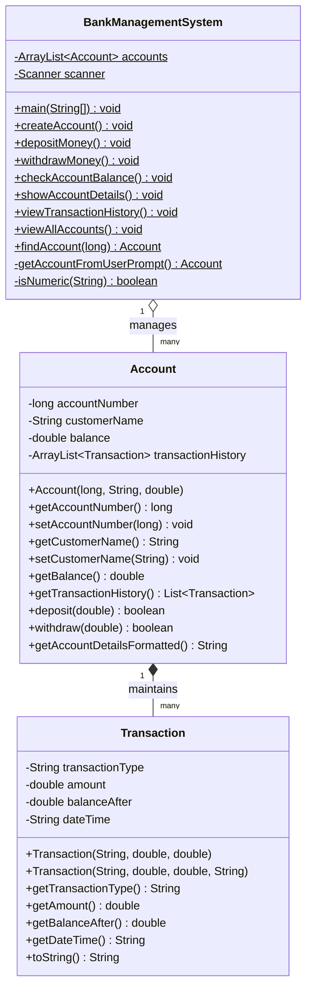

# Project Documentation: Bank Management System

**Task 4 – Core Java Internship Project**  
**Module**: Object-Oriented Programming and Console Application Development  

---

## Table of Contents

1. [Introduction](#1-introduction)
2. [Objective](#2-objective)
3. [Task Requirements](#3-task-requirements)
4. [System Features](#4-system-features)
5. [Class Design](#5-class-design)
6. [Account Class](#6-account-class)
7. [Transaction Class](#7-transaction-class)
8. [Bank Management System Class](#8-bank-management-system-class)
9. [Deposit Logic](#9-deposit-logic)
10. [Withdrawal Logic](#10-withdrawal-logic)
11. [Balance Checking](#11-balance-checking)
12. [Transaction Validation](#12-transaction-validation)
13. [Transaction History](#13-transaction-history)
14. [Input Validation](#14-input-validation)
15. [Testing](#15-testing)
16. [Sample Output](#16-sample-output)
17. [Conclusion](#17-conclusion)

---

## 1. Introduction

The **Bank Management System** is a standalone, console-based banking application developed in **Core Java**. It simulates real-world banking operations including customer onboarding, fund deposits, cash withdrawals, balance inquiries, and detailed transaction ledger auditing. The application relies entirely on standard Java constructs, avoiding external libraries, GUI frameworks, or external databases, making it an ideal demonstration of clean code, data structures, and Object-Oriented Programming (OOP) principles.

---

## 2. Objective

The primary objectives of this project are:
- To design and implement an in-memory banking management system using Java collection frameworks (`ArrayList`).
- To enforce strict OOP principles (Encapsulation, Data Hiding, Composition, and Abstraction).
- To implement comprehensive defensive programming and input validation to guarantee zero runtime crashes.
- To maintain an accurate, chronological, and immutable audit trail of all successful banking transactions.
- To produce clean, well-documented, and internship-ready production-grade Java source code.

---

## 3. Task Requirements

The application fulfills all foundational and business specifications outlined below:

- **Core Java Only**: Pure Java SE (JDK 8+) with no third-party dependencies or GUI frameworks.
- **In-Memory Storage**: Uses dynamic generic collections (`ArrayList<Account>` and `ArrayList<Transaction>`).
- **Encapsulation**: All data fields are declared `private` with public accessors and business methods.
- **Unique Account Identification**: Validates account numbers for positivity and uniqueness across the system.
- **Transactional Integrity**: Only successful deposits and withdrawals are recorded in the history.
- **Interactive Console Interface**: An 8-option continuous menu loop with clear status messages and formatted tables.

---

## 4. System Features

| Feature ID | Feature Name | Description |
| :--- | :--- | :--- |
| **F-01** | **Create Account** | Registers a new account with a unique number, customer name, and non-negative initial deposit. |
| **F-02** | **Deposit Money** | Credits money to an existing account and logs the transaction with current timestamp. |
| **F-03** | **Withdraw Money** | Debits money from an existing account after validating positive amount and sufficient balance. |
| **F-04** | **Check Balance** | Displays customer name, account number, and current account balance. |
| **F-05** | **Show Account Details** | Displays structured account information inside an aligned banner. |
| **F-06** | **View Transaction History** | Displays a tabular ledger of all successful deposits and withdrawals with balance tracking. |
| **F-07** | **View All Accounts** | Renders an administrative tabular overview of all customer accounts in the bank. |
| **F-08** | **System Exit** | Terminates the application safely with a farewell message. |

---

## 5. Class Design

The system is organized into three primary classes adhering to the Single Responsibility Principle:



---

## 6. Account Class

`Account.java` serves as the core domain model representing a bank account.

### Key Attributes:
- `private long accountNumber`: Unique identifier for the account.
- `private String customerName`: Name of the account holder.
- `private double balance`: Current balance in the account.
- `private final ArrayList<Transaction> transactionHistory`: List of chronological transaction logs.

### Key Responsibilities:
- Managing balance mutations safely through `deposit()` and `withdraw()`.
- Recording initial deposit during account creation if greater than zero.
- Returning an unmodifiable view of transaction history (`Collections.unmodifiableList()`) to prevent unauthorized external modifications.

---

## 7. Transaction Class

`Transaction.java` represents an immutable record of an individual financial movement.

### Key Attributes:
- `private final String transactionType`: Either `"DEPOSIT"` or `"WITHDRAWAL"`.
- `private final double amount`: Monetary value of the transaction.
- `private final double balanceAfter`: Resulting balance immediately following the transaction.
- `private final String dateTime`: Formatted timestamp (`yyyy-MM-dd HH:mm:ss`) when the transaction occurred.

### Key Responsibilities:
- Encapsulating transaction metadata.
- Providing aligned string representation via `toString()` for ledger rendering.

---

## 8. Bank Management System Class

`BankManagementSystem.java` is the application orchestrator and user interface controller.

### Key Responsibilities:
- Hosting the central `static ArrayList<Account>` storage.
- Managing the continuous command-line menu loop.
- Reading and validating all user inputs (preventing buffer desynchronization).
- Formatting console outputs into legible tables and structured banners.

---

## 9. Deposit Logic

The deposit process ensures balance consistency and prevents invalid financial transactions:

1. Prompt user for `accountNumber`.
2. Locate account via `findAccount()`. If not found, display `"Account not found."` and abort.
3. Prompt user for `amount`.
4. Validate that amount is numeric and strictly greater than zero ($amount > 0$). If invalid, display `"Invalid amount. Please enter a positive amount."` and abort.
5. Invoke `account.deposit(amount)`:
   - Increments `balance` by `amount`.
   - Creates a new `Transaction` instance with type `"DEPOSIT"`, `amount`, and new `balance`.
   - Appends the transaction to `transactionHistory`.
6. Display `"Deposit successful."` followed by `"Updated Balance: INR <balance>"`.

---

## 10. Withdrawal Logic

The withdrawal mechanism protects against overdrafts and invalid deductions:

1. Prompt user for `accountNumber`.
2. Locate account via `findAccount()`. If not found, display `"Account not found."` and abort.
3. Prompt user for `amount`.
4. Validate that amount is numeric and strictly greater than zero ($amount > 0$). If invalid, display `"Invalid amount. Please enter a positive amount."` and abort.
5. Validate that amount does not exceed `account.getBalance()` ($amount \le balance$). If insufficient, display `"Insufficient balance."` and abort.
6. Invoke `account.withdraw(amount)`:
   - Decrements `balance` by `amount`.
   - Creates a new `Transaction` instance with type `"WITHDRAWAL"`, `amount`, and new `balance`.
   - Appends the transaction to `transactionHistory`.
7. Display `"Withdrawal successful."` followed by `"Updated Balance: INR <balance>"`.

---

## 11. Balance Checking

Provides quick, non-destructive access to account balance information:
- Prompts for account number.
- Verifies account existence.
- Outputs account number, customer name, and formatted balance in standard currency format.

---

## 12. Transaction Validation

The system implements strict business validation rules:
- **No Negative or Zero Deposits**: Disallowed at both input and domain layer.
- **No Negative or Zero Withdrawals**: Disallowed at both input and domain layer.
- **Overdraft Prevention**: Withdrawals greater than current balance are rejected immediately.
- **No Ghost Transactions**: Only valid, successfully applied transactions generate log entries in `transactionHistory`. Failed operations leave the history untouched.

---

## 13. Transaction History

The transaction history feature generates a chronological ledger report:

```text
========================================================
                  TRANSACTION HISTORY
========================================================
Type          Amount          Balance After       Date/Time
--------------------------------------------------------
DEPOSIT       5000.00         15000.00            2026-10-03 21:30:15
WITHDRAWAL    2000.00         13000.00            2026-10-03 21:35:42
========================================================
```

If an account was opened with zero initial deposit and has no subsequent operations, the system outputs:
`No transaction history available.`

---

## 14. Input Validation

Defensive programming techniques are employed across all input stages:
- **Numeric Verification**: Helper method `isNumeric()` and `try-catch` blocks for `Long.parseLong()` and `Double.parseDouble()`.
- **Buffer Safety**: Reading inputs via `scanner.nextLine().trim()` avoids standard Java `Scanner` newline entrapment issues.
- **Name Non-Empty Check**: Enforces non-blank customer names.
- **Menu Choice Handling**: Default fallback in `switch-case` catches non-existent options without throwing exceptions.

---

## 15. Testing

A comprehensive suite of 19 distinct tests was performed to validate all functional paths and edge cases:

| Test ID | Test Scenario | Expected Outcome | Result |
| :--- | :--- | :--- | :--- |
| **Test 1** | Create account with valid number and name | Account created successfully | **PASS** |
| **Test 2** | Create account with positive initial deposit | Account created; initial DEPOSIT transaction logged | **PASS** |
| **Test 3** | Create account with duplicate account number | Rejected with duplicate account error | **PASS** |
| **Test 4** | Deposit a valid positive amount | Balance credited; DEPOSIT transaction logged | **PASS** |
| **Test 5** | Deposit zero amount (`0.00`) | Rejected with `"Invalid amount"` error; no log | **PASS** |
| **Test 6** | Deposit negative amount (`-500.00`) | Rejected with `"Invalid amount"` error; no log | **PASS** |
| **Test 7** | Withdraw a valid positive amount ($\le balance$) | Balance debited; WITHDRAWAL transaction logged | **PASS** |
| **Test 8** | Withdraw amount greater than balance | Rejected with `"Insufficient balance."`; no log | **PASS** |
| **Test 9** | Withdraw zero amount (`0.00`) | Rejected with `"Invalid amount"` error; no log | **PASS** |
| **Test 10** | Withdraw negative amount (`-300.00`) | Rejected with `"Invalid amount"` error; no log | **PASS** |
| **Test 11** | Check account balance for existing account | Correct account number, name, and balance shown | **PASS** |
| **Test 12** | Show account details for existing account | Formatted details banner displayed correctly | **PASS** |
| **Test 13** | View transaction history for account with zero transactions | Displays `"No transaction history available."` | **PASS** |
| **Test 14** | Verify successful deposits & withdrawals in history | All successful operations displayed in order | **PASS** |
| **Test 15** | Verify failed transactions are NOT added to history | Only valid operations present in history table | **PASS** |
| **Test 16** | Search / interact with non-existing account | Displays `"Account not found."` gracefully | **PASS** |
| **Test 17** | View all accounts in tabular view | All registered accounts displayed in formatted table | **PASS** |
| **Test 18** | Enter invalid menu option (e.g. `99`, `abc`) | Displays invalid choice message without crashing | **PASS** |
| **Test 19** | Exit application (Option 8) | Displays farewell message and terminates cleanly | **PASS** |

---

## 16. Sample Output

### Account Creation & Initial Deposit
```text
========================================
        BANK MANAGEMENT SYSTEM
========================================
1. Create Account
2. Deposit Money
3. Withdraw Money
4. Check Account Balance
5. Show Account Details
6. View Transaction History
7. View All Accounts
8. Exit

Enter your choice: 1

--- CREATE ACCOUNT ---
Enter Account Number: 1001
Enter Customer Name: Alice Smith
Enter Initial Deposit: 10000
Account created successfully.
```

### Performing Transactions
```text
Enter your choice: 2

--- DEPOSIT MONEY ---
Enter Account Number: 1001
Enter Deposit Amount: 5000
Deposit successful.
Updated Balance: INR 15000.00

Enter your choice: 3

--- WITHDRAW MONEY ---
Enter Account Number: 1001
Enter Withdrawal Amount: 2000
Withdrawal successful.
Updated Balance: INR 13000.00
```

### Transaction History Verification
```text
Enter your choice: 6

--- VIEW TRANSACTION HISTORY ---
Enter Account Number: 1001
========================================================
                  TRANSACTION HISTORY
========================================================
Type          Amount          Balance After       Date/Time
--------------------------------------------------------
DEPOSIT       10000.00        10000.00            2026-10-03 21:30:00
DEPOSIT       5000.00         15000.00            2026-10-03 21:31:12
WITHDRAWAL    2000.00         13000.00            2026-10-03 21:32:45
========================================================
```

---

## 17. Conclusion

The **Bank Management System** successfully delivers an efficient, reliable, and user-friendly console application meeting all functional and non-functional requirements. Through clean class design, complete encapsulation, and comprehensive defensive programming, the system demonstrates the highest standards of Core Java software engineering.
